# Файловая система Linux · отчёт

ФИО: Продан Илья  
Группа: РПО1  
Дата: 31 октября 2026 г.  
Среда: Ubuntu 26.04, изолированная учебная среда, пользователь `student`.

> Снимки оформлены из фактического вывода команд без путей хранилища хоста.

## Корневой каталог и домашний каталог

Корень `/` — вершина единого дерева каталогов. Абсолютный путь начинается
с `/`; относительный отсчитывается от текущего каталога. Домашний каталог
учётной записи — `/home/student`; файлы, начинающиеся с точки, скрыты при
обычном `ls`.

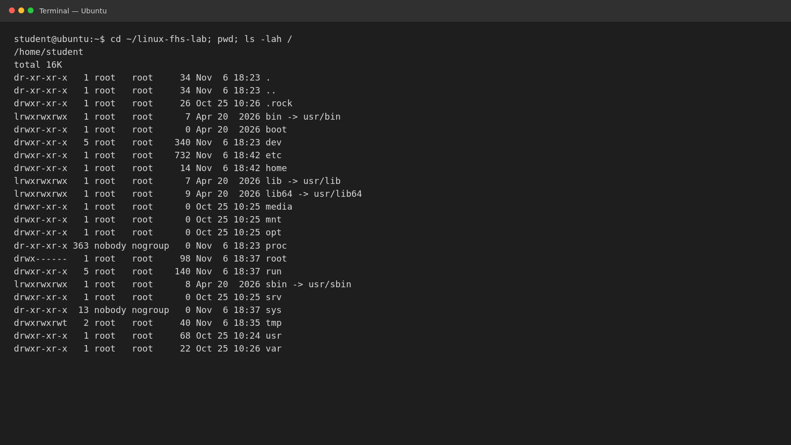
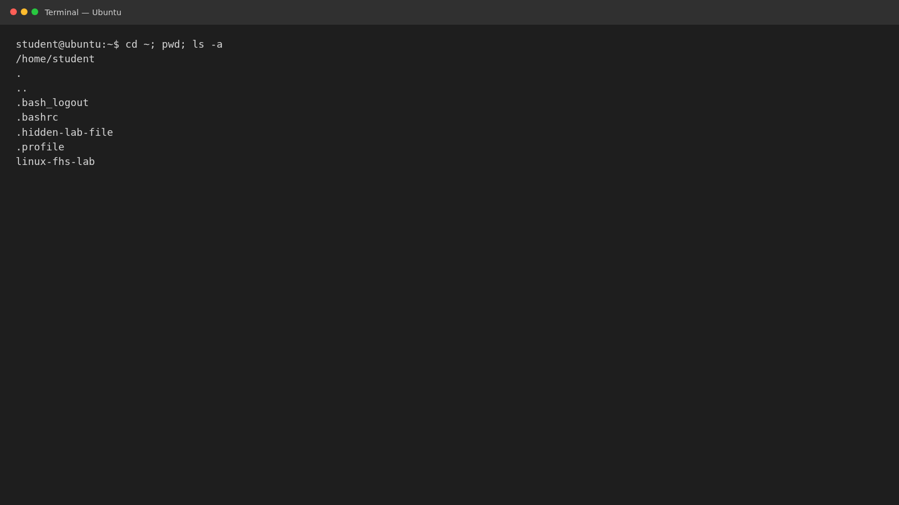

## Системные каталоги и программы

Система сообщает Ubuntu 26.04.1 LTS. Учётная запись `student` имеет UID/GID
1001. Оболочка ищет внешние команды в каталогах `PATH`; `cd` — встроенная
команда оболочки.

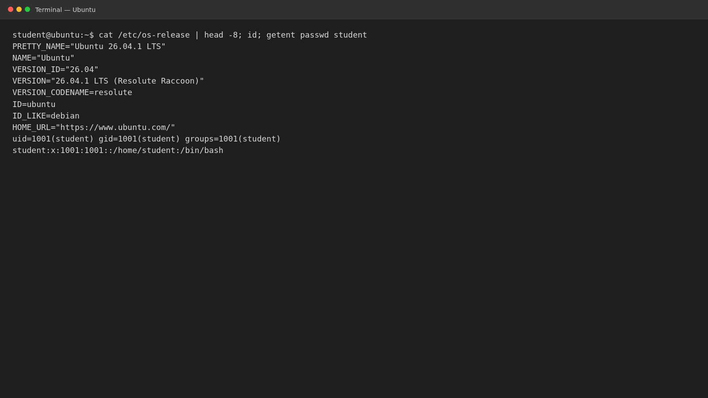
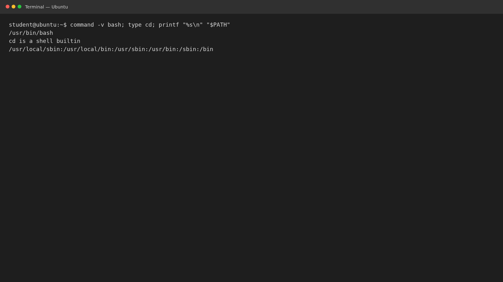

## Изменяемые данные, устройства, proc и sys

`/var/lib` хранит изменяемое состояние приложений, `/var/log` — журналы,
`/var/cache` — кэш; `/run` хранит временные данные работающей системы. `/dev/null` —
символьное устройство с кодом `1,3`; успешная команда возвращает 0.
Значение `/proc/uptime` меняется при чтении, а скопированная строка остаётся
неизменной. В `/sys/class/net` видны `lo` и `wlp2s0`.

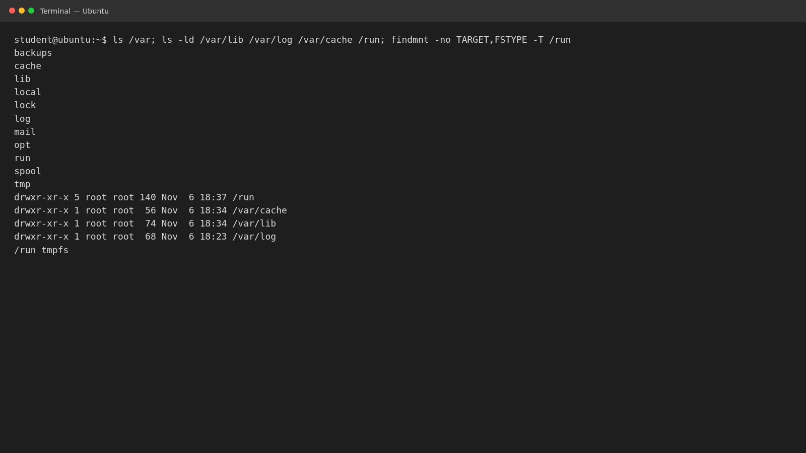
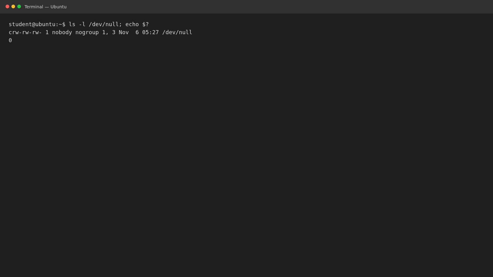
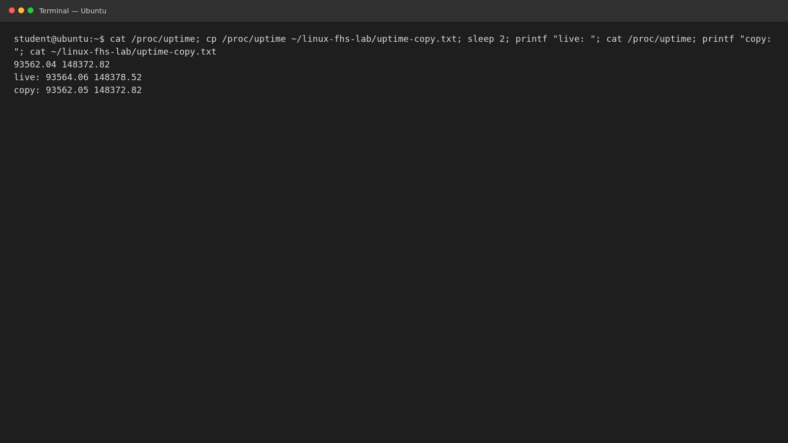
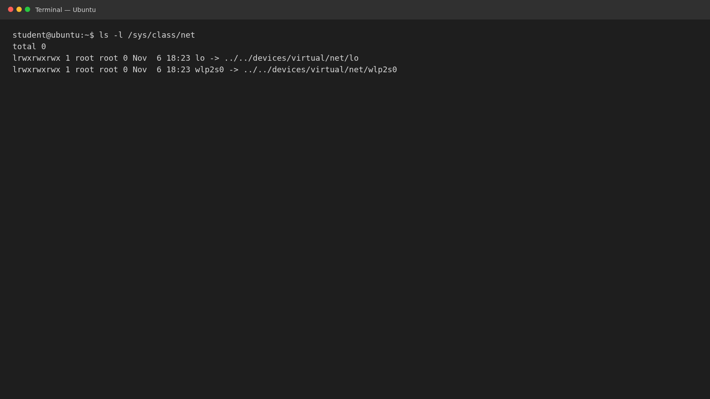

## inode, ссылки и место на диске

Жёсткая ссылка указывает на тот же inode и сохраняет данные после удаления
другого имени. Символическая ссылка хранит путь и становится нерабочей,
если целевой путь удалён. `df` показывает свободное место файловой системы,
`du` — объём выбранного каталога.

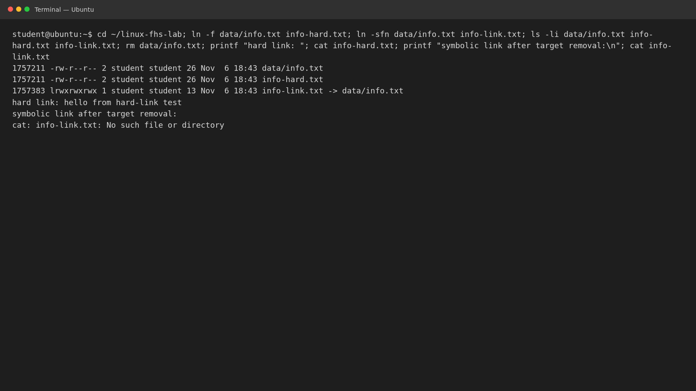
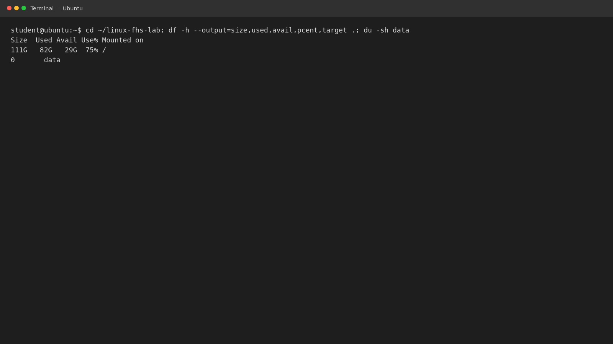

## Модель размещения shop-api

| Файл | Решение и правильный путь | Основание |
|---|---|---|
| `/home/admin/shop.log` | заменить на `/var/log/shop-api/shop.log` | журналы службы размещают в `/var/log` |
| `/usr/bin/config.json` | заменить на `/etc/shop-api/config.json` | настройки отделены от файлов программы |
| `/tmp/database.db` | заменить на `/var/lib/shop-api/database.db` | постоянные данные нельзя хранить во временном каталоге |
| `/etc/shop-api/app.conf` | оставить | системная конфигурация службы |
| `/var/log/shop-api/access.log` | оставить | журнал приложения |
| `/var/lib/shop-api/database.db` | оставить | постоянные данные приложения |

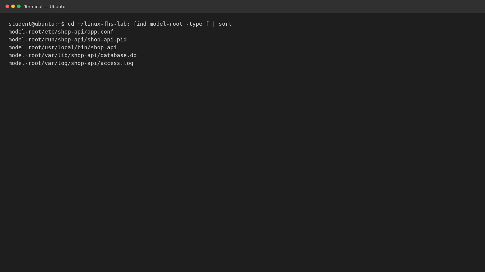

Программа размещается в `/usr/local/bin` (или в каталоге пакета `/usr/bin`),
настройки — в `/etc/shop-api`, данные — в `/var/lib/shop-api`, журналы —
в `/var/log/shop-api`, PID-файл работающей службы — в `/run/shop-api`.
