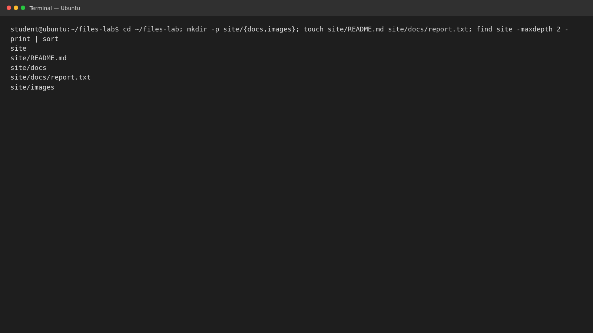
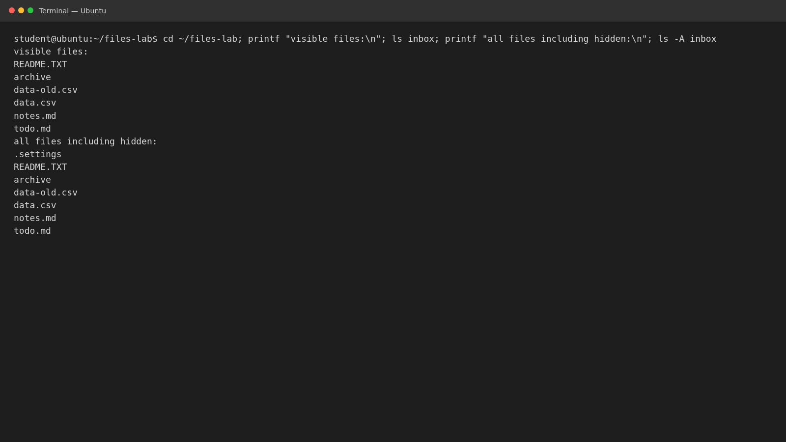
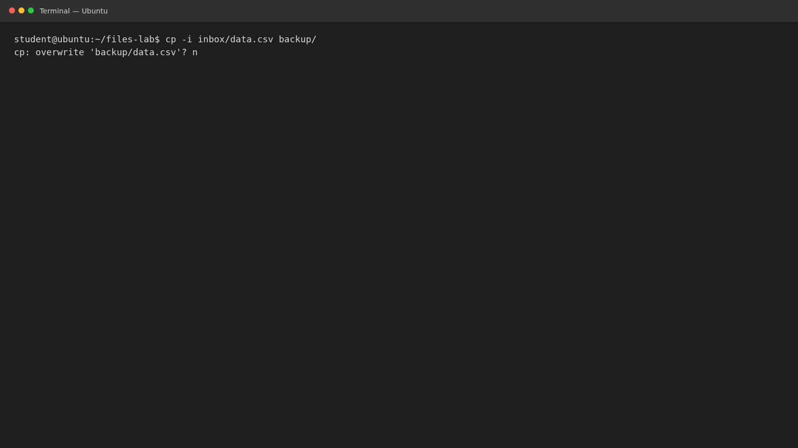
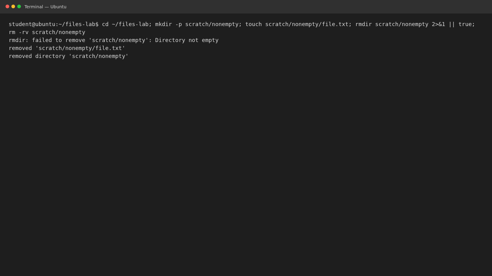
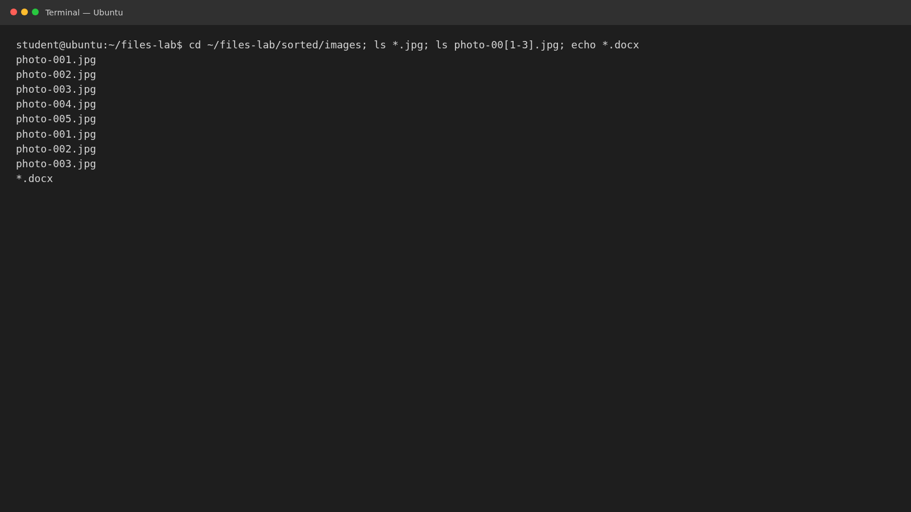
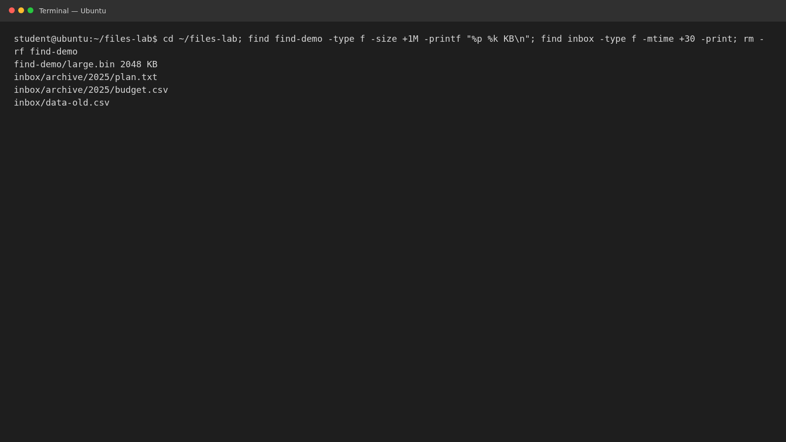
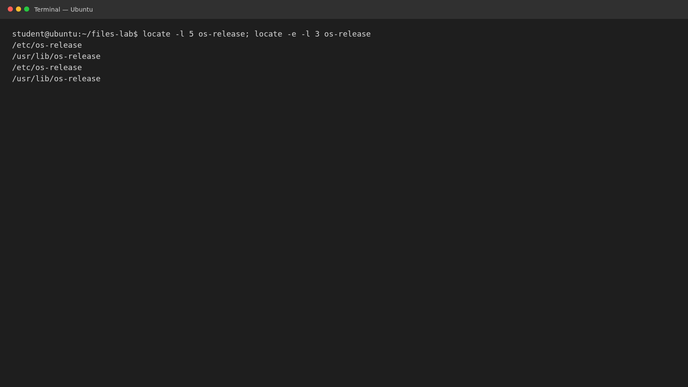
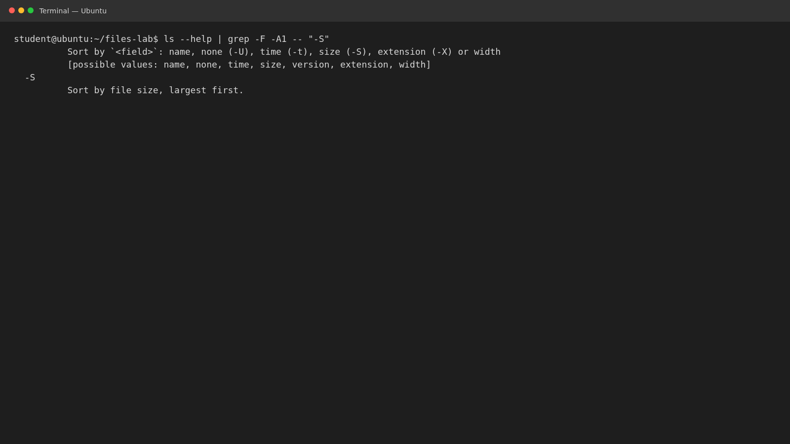
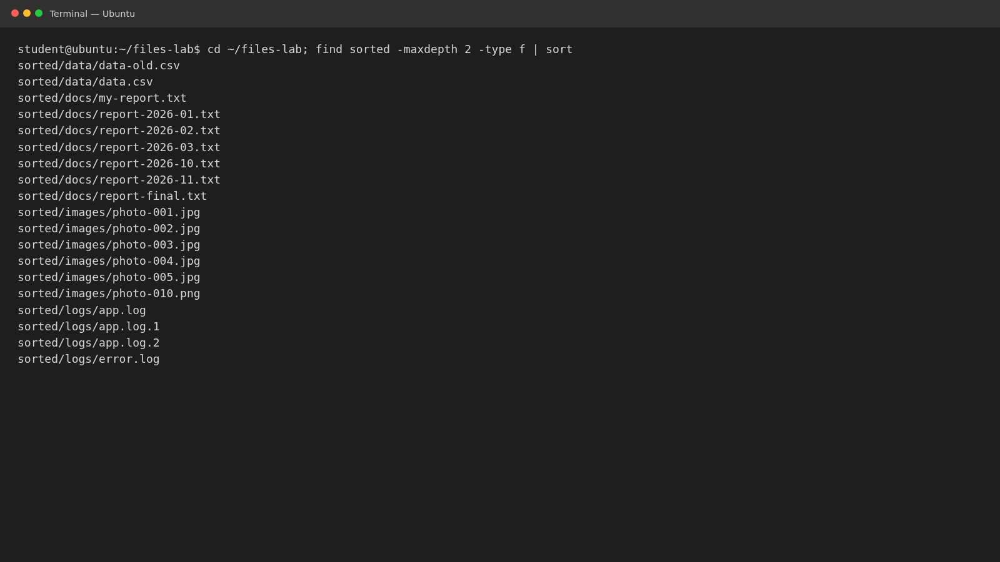
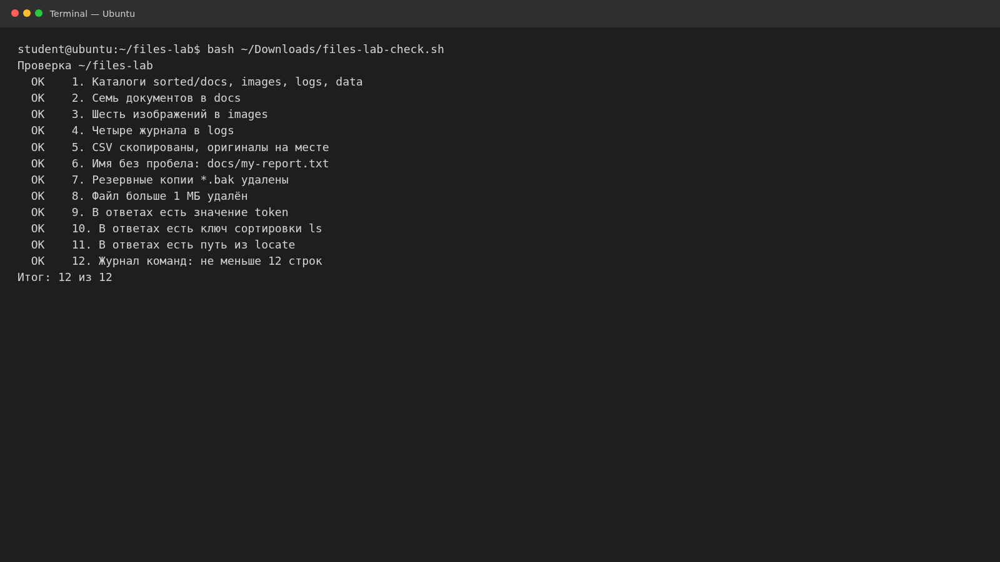

# Файлы, маски, поиск и справка · отчёт

ФИО: Продан Илья  
Группа: РПО1  
Дата: 31 октября 2026 г.  
Среда: Ubuntu 26.04, изолированная учебная среда, пользователь `student`.

> Результаты получены запуском команд практической работы. Это не снимки
> экрана личной виртуальной машины. В минимальном образе отсутствует страница
> `man ls`, поэтому ключ сортировки проверен через `ls --help`.

## Каталог site

`mkdir -p` создала каталоги `site/docs` и `site/images`, а `touch` — файлы.
Без `-p` команда `mkdir` завершится ошибкой, если родительского каталога нет
или каталог уже существует.

## Учебный набор

`ls` не показывает имена, начинающиеся с точки; `ls -A` показывает скрытый
файл `.settings`.

## Копирование с вопросом

`cp -i` запросила подтверждение при совпадении имён. Ответ `n` оставил
существующий файл без изменений. Обычная `cp` перезаписала бы его.

## Удаление каталога

`rmdir` отказалась удалять непустой каталог. `rm -r` удалила его содержимое
и сам каталог; перед таким удалением нужно проверить путь и содержимое.

## Маски

Маски раскрывает оболочка до запуска команды. Квадратные скобки выбрали
изображения `photo-001.jpg`–`photo-003.jpg`. Если совпадений нет,
некавыченная маска передаётся программе буквально — это видно на примере
`*.docx`.

## Поиск find

`find -size +1M` обнаружила созданный для опыта файл размером 2048 KB;
перед удалением он был показан отдельной командой. `-mtime +30` нашёл три
файла старше 30 суток. Маска размера в `find` округляется по единицам,
поэтому для файлов меньше 1 MiB используют подходящее условие, например
`-size -1M`.

## Поиск locate

`locate` нашла `/etc/os-release` и `/usr/lib/os-release`. Результат берётся
из индекса; после изменений файловой системы индекс обновляют `updatedb`.
Ключ `-e` ограничивает выдачу существующими путями.

## Справка

Образ системы не содержит страницу `man ls`; доступная краткая справка
`ls --help` указывает `-S` для сортировки по размеру, сначала самые большие.

## Результат квеста

В `sorted` находятся 7 документов, 6 изображений, 4 журнала и 2 копии CSV.
Исходные CSV остались в `inbox`.

## Проверка

Официальная проверка завершилась результатом **12 из 12**.

## Ответы

Список файлов старше 30 суток, значение скрытого файла, команда сортировки
и путь из `locate` записаны в [answers.txt](answers.txt). Команды и безопасные
варианты — в [journal.md](journal.md).
