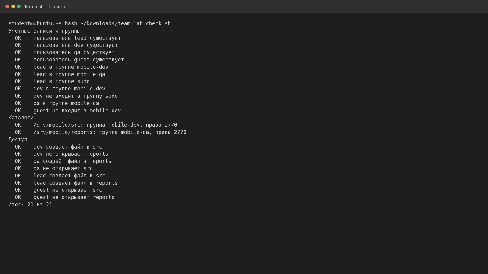
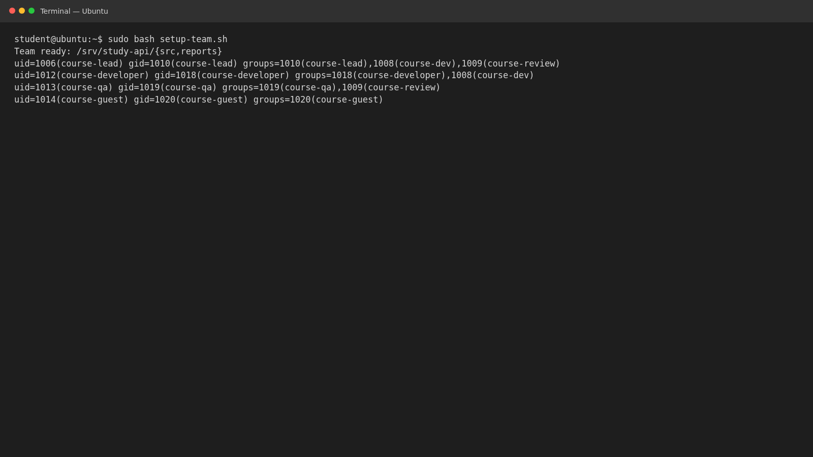

# Пользователи, группы и sudo · отчёт

ФИО: Продан Илья  
Группа: РПО1  
Дата: 31 октября 2026 г.  
Среда: Ubuntu 26.04, изолированная учебная среда.

## Модель mobile-app

Созданы пользователи `lead`, `dev`, `qa`, `guest` и группы `mobile-dev`,
`mobile-qa`. `lead` входит в обе проектные группы и `sudo`; `dev` и `qa`
получили только необходимые дополнительные группы. `guest` не имеет доступа
к общим каталогам.

Каталог `/srv/mobile/src` принадлежит группе `mobile-dev`, а
`/srv/mobile/reports` — `mobile-qa`. Оба имеют права `2770`: владелец и группа
могут работать с содержимым, остальные не имеют доступа; setgid наследует
группу каталога.

Таблица тестов доступа: [access-tests.md](access-tests.md). Проверка модели:
**21 из 21**. Ограничения sudo не удалось исследовать в журнале systemd:
`journalctl` отсутствует в среде.

## Собственная модель и скрипт

Для проекта `study-api` определены четыре роли и отдельные группы
разработчиков и тестировщиков. [access-model.md](access-model.md) описывает
доступ к исходникам и отчётам. Скрипт [setup-team.sh](setup-team.sh)
идемпотентно создаёт группы, учётные записи и каталоги; он выполнен в
изолированной среде.

