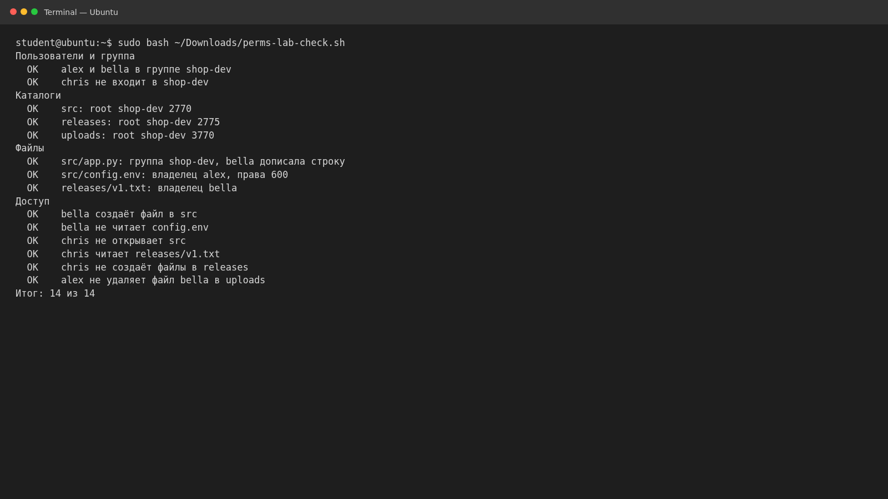

# Права доступа, владельцы и umask · отчёт

ФИО: Продан Илья  
Группа: РПО1  
Дата: 31 октября 2026 г.  
Среда: Ubuntu 26.04, изолированная учебная среда.

Каталоги `/srv/shop/src`, `/srv/shop/releases` и `/srv/shop/uploads`
настроены с правами `2770`, `2775` и `3770`. Установлены владелец и группа
файлов; разработчики совместно записали в `app.py`, а `config.env` закрыт
правами `600`.

Проверка практики завершилась результатом **14 из 14**. Групповая запись
в `app.py` потребовала права `664`; sticky-бит запретил Alex удалять файл
Bella из `uploads`. Собственная модель проекта приведена в
[permissions.md](permissions.md).
