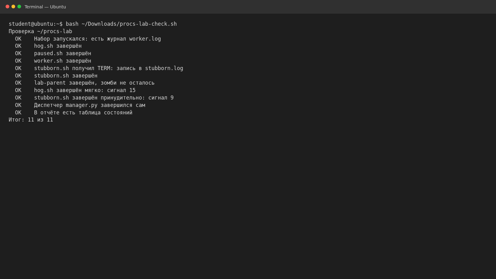

# Процессы: PID, состояния и сигналы · отчёт

ФИО: Продан Илья  
Группа: РПО1  
Дата: 31 октября 2026 г.  
Среда: Ubuntu 26.04, изолированная учебная среда.

В наборе `procs-lab` наблюдались состояния `R` (выполнение), `S` (ожидание),
`T` (остановлен сигналом) и `Z` (завершённый потомок, ожидающий родителя).
Таблица состояний сохранена в [states.md](states.md).

`hog.sh` завершён TERM (signal 15), `stubborn.sh` записал обработку TERM и
завершён KILL (signal 9). Родитель `lab-parent` завершён; checker показал
**11 из 11**. Таблица результатов и цепочка процессов — в
[processes.md](processes.md); скрипт с обработчиком TERM —
[graceful.sh](graceful.sh).

