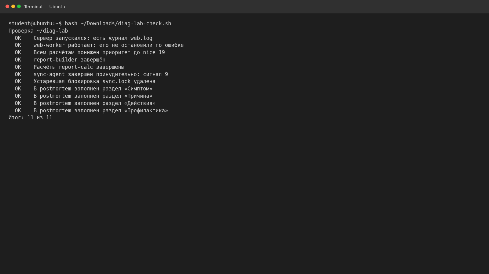

# Диагностика процессов и управление ресурсами · отчёт

ФИО: Продан Илья  
Группа: РПО1  
Дата: 31 октября 2026 г.  
Среда: Ubuntu 26.04, изолированная учебная среда.

Во время инцидента нагрузка составила 4.27 при четырёх CPU, задержки
`web-worker` достигали 996–2359 мс. `ps` выявила восемь CPU-bound процессов
`report-calc`. Им назначен nice 19, затем завершены builder и расчёты.
Зависший `sync-agent` завершён KILL, `sync.lock` удалён, веб-процесс оставлен
работать.

Практическая проверка: **11 из 11**. Postmortem: [postmortem.md](postmortem.md).
Собственный разбор и результат `/usr/bin/time`: [incident.md](incident.md).

